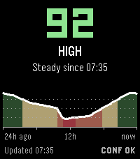
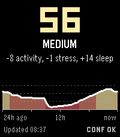
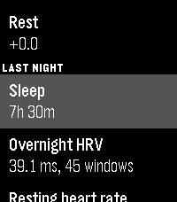
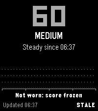

# Ebb

A 0 to 100 body energy reserve measurement app for the Pebble Time 2, computed on the watch
from heart rate variability, heart rate, movement and sleep. No account, no cloud, no network
calls.

It is an estimate, not medical advice.

Install it from the Pebble app store:
[Ebb: Body Energy Reserve](https://apps.repebble.com/afae45fe97914bc5b35d3711).

| Main | With a reason line | Breakdown | Not worn |
| --- | --- | --- | --- |
|  |  |  |  |

Emulator screenshots. The first three use synthetic demo data.

## What it does

- **Main screen:** score, state in words, a one-line reason for what changed since you last
  looked, a 24-hour curve, last-updated time and a confidence flag.
- **Select:** breakdown of every term behind the score, last night's inputs, your baseline,
  and what the sampler is doing (windows kept, sensor-on minutes, watch battery use).
- **Background sampler:** measures HRV in short bursts while you are asleep or still, then
  releases the sensor.
- **Phone settings:** sampling intensity, HRV units, maximum heart rate, reset baseline.

The scoring model is written up in [docs/SCORING.md](docs/SCORING.md).

## Requirements

| | Version | Why |
| --- | --- | --- |
| Watch | Pebble Time 2 (`emery`) | The only watch whose sensor reports HRV |
| PebbleOS | 4.32 or later | First firmware with the HRV API; the app checks at launch. Run on 4.44.4 |
| Pebble SDK | 4.44 | First SDK checked here whose worker header carries the HRV calls |
| pebble-tool | 5.1.0 or later | Required by SDK 4.44 |

Heart-rate monitoring must be on in the watch's Health settings. The firmware refuses HRV to
a background worker otherwise, and the app says so.

## Build and run

```bash
npm install
```

```bash
pebble build
```

```bash
pebble install --phone <phone-ip>
```

Over the Pebble account connection instead of an IP address (switch on Dev Connection for the
watch in the phone app's Devices tab first):

```bash
pebble install --cloudpebble --logs
```

## Development

[docs/DEVELOPMENT.md](docs/DEVELOPMENT.md) has the project status, emulator and debug builds,
tests, code layout, PRD coverage, and what the first days on a wrist showed. Coding agents
should read it, and [docs/SCORING.md](docs/SCORING.md), before changing the code.

## Licence

Apache-2.0; see [LICENSE](LICENSE) and [NOTICE](NOTICE). If you build on this, keep the
NOTICE file with your copy and link back to this project.
