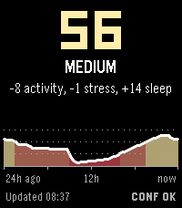
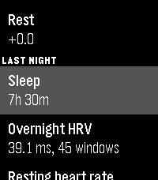
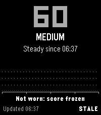

# Ebb user guide

Ebb shows one number from 0 to 100 for how much energy your body has in reserve. It refills
while you sleep and drains through the day, faster when you move or are under strain. The
watch works it out on its own from heart rate, heart rate variability (HRV), movement and
sleep. Nothing leaves the watch except a small backup to your own phone.

It is an estimate, not medical advice, and it does not diagnose anything.

This guide covers version 0.5.3. The app is an early release and the scoring is still being
tuned.

## Setting up

You need a Pebble Time 2 on PebbleOS 4.32 or later. No other Pebble has the sensor Ebb uses.

1. Switch on heart-rate monitoring in the watch's Health settings. Ebb cannot measure HRV
   without it and will tell you so.
2. Install [Ebb: Body Energy Reserve](https://apps.repebble.com/afae45fe97914bc5b35d3711)
   from the Pebble app store.
3. Open Ebb on the watch. Read the notice and press Select to continue. Pressing Back
   instead closes the app and nothing starts.
4. If the watch asks whether Ebb may run in the background, say yes. Ebb measures HRV and
   keeps the score up to date from the background, and a Pebble runs only one app's
   background worker at a time.

## The first few days

- **The first number is a placeholder.** A new install starts at 40 because it has seen
  nothing yet. It becomes meaningful after your first night.
- **The first three nights are calibration.** Ebb needs three nights of HRV to learn what is
  normal for you. Until then the screen says "Calibrating: night 1 of 3" and the score runs
  on heart rate, sleep and movement only.
- **Wear it to bed.** Sleep is the only large source of recharge. A night off the wrist is a
  night Ebb never sees.

## Reading the main screen

From top to bottom:

| Part | What it tells you |
| --- | --- |
| Score | Your reserve now, 0 to 100. Grey when the watch is not being worn |
| State | The score in words (see the table below) |
| Reason line | What changed since you last closed the app, for example `-8 activity, -3 stress, +5 rest`. "Steady since 14:05" means nothing has moved |
| Curve | The last 24 hours, oldest on the left. Dotted lines mark the boundaries between states. Gaps are times the watch was off your wrist |
| Notice | One line, only when something needs explaining (see [Messages](#messages)) |
| Footer | When the score was last updated, and how far to trust it |

| Score | State | Colour |
| --- | --- | --- |
| 76 to 100 | High | Green |
| 51 to 75 | Medium | Yellow |
| 26 to 50 | Low | Amber |
| 0 to 25 | Very low | Orange-red |

The footer's trust flag is one of three:

- **CONF OK:** Ebb has what it needs.
- **LOW CONF:** the number is a rougher guess than usual: still calibrating, just back on the
  wrist, or last night had no usable HRV.
- **STALE:** the watch is not being worn, so the number is not being measured.

The score can trail real time by up to 20 minutes, because the watch writes its history with
a delay.

## Buttons

| Button | What it does |
| --- | --- |
| Select | Opens the breakdown |
| Select, held | Takes an HRV measurement now. The watch buzzes once at the start and twice when done. Sit still for about a minute and a half |
| Back | Leaves the app. Ebb keeps measuring and scoring in the background |

## The breakdown

Press Select on the main screen. Up and Down scroll.

| Section | What is in it |
| --- | --- |
| Today | The score, your morning charge (the score when you woke), and how much activity, stress, rest and time off the wrist have each added or taken since then |
| Last night | Time asleep, overnight HRV and how many measurements it came from, resting heart rate |
| Baseline | Your usual overnight HRV and resting heart rate, and how many nights they rest on |
| Sampler | Whether background measuring is running, how many HRV measurements it kept in the last 24 hours, how long the sensor was held on, and the watch's overall battery use per day |

## What moves the score

These are typical figures when the score is around 50. Yours shift with your own resting
heart rate and HRV.

| What you are doing | Effect per hour, at a score near 50 |
| --- | --- |
| Asleep, heart rate near your resting level | Up about 10; a little more in deep sleep |
| Asleep with a raised heart rate (after alcohol, a late meal, illness, a late workout) | Up as little as 3 |
| Lying or sitting with your heart rate close to its sleeping level | Up about 4 |
| Sitting, awake | Down 2 to 4 |
| On your feet: housework, cooking, standing about | Down about 3 |
| Easy walking | Down 7 to 9 |
| Hard exercise | Down 25 or more |
| Still, but heart rate well above resting or HRV low (strain) | Down up to 11 |
| Watch off your wrist during the day | Down about 2, as a guess |

Everything slows down as the score nears the end it is heading for:

- **Drains take a share of what is left.** The same walk costs about two thirds more at 90
  than at 45, and under half as much at 10.
- **Sleep fills a share of what is missing.** A night adds more points when you go to bed at
  15 than when you go to bed at 60.

Three things follow from this:

- **The score settles into your own range.** If your days cost more than your nights give
  back, you will run lower overall, perhaps 15 to 75. With calm days and long nights it
  might be 45 to 88. It should not sit at 0 or pin at 100.
- **The top is hard to reach.** A good night after an ordinary day gives a morning of about
  80 to 85, and after a heavy day about 75. Do not expect 100.
- **Sitting still does not recharge you.** Your resting heart rate is measured while you
  sleep, and sitting awake is normally well above it. Only something close to lying down at
  rest gives a little back.

The breakdown files ordinary sitting under "stress". It is the same measurement at a low
level, the small cost of being up, and does not mean you were tense.

## Getting the most from it

- **Wear it every night.** Without the night, the morning number is carried over from
  yesterday.
- **Looking at it in the night is fine.** Pebble Health decides you were asleep an hour or
  more after the fact. If you check the score in bed, it may not move at first; it is
  corrected the next time the app updates, and that includes time spent lying still that
  Pebble Health counts as sleep.
- **You do not need to keep opening it.** Ebb brings the score up to date every 15 minutes
  in the background, so it is current when you look. This depends on Ebb holding the
  watch's one background slot: if another app takes it, Ebb scores only while it is open,
  and leaving it unopened for more than two days restarts the score.
- **Wear the watch snug**, just above the wrist bone. A loose watch gives poor heart-rate
  and HRV readings, and Ebb throws poor readings away.
- **Set your maximum heart rate** in the settings (see below). It decides how hard Ebb
  thinks a workout was. 220 minus your age is a rough guide; use a measured figure if you
  have one.
- **Compare with yourself.** The number is built on your own baseline. Yesterday's and last
  week's readings are the useful comparison, not someone else's.
- **Look at the curve as well as the number.** How fast you drain through a day, and how far a
  night brings you back, says more than any single reading.
- **Expect it to settle.** The first week moves around while the baseline forms.

## When the watch is off your wrist

Ebb decides the watch is off when it has had no heart rate for 30 minutes and no steady
movement. The notice appears 30 to 50 minutes after you take it off. A watch lying on a desk
still counts as off when a notification buzzes it or it gets nudged.

| How long it is off | What happens | What you see |
| --- | --- | --- |
| During the day, up to 16 hours after you woke | The score drains at about 2 points an hour (less when it is low), a guess at an ordinary day | "Not worn: estimating" |
| Overnight, or longer | The score freezes | "Not worn: score frozen" |
| Back on after an hour or more | Carries on from where it was | "Resumed after a gap", LOW CONF until the next full night |
| Back on after a day or more | Restarts at 40. Your baseline is kept | "Restarted after time off", LOW CONF until the next full night |

Ebb does not measure while the watch is on its charger.

## Messages

| Message | Meaning | What to do |
| --- | --- | --- |
| Calibrating: night 1 of 3 | The baseline is still forming | Keep wearing it at night |
| Measuring HRV: keep still | A measurement you asked for is running | Sit still until the double buzz |
| Not worn: estimating | Off the wrist during the day; the score is a guess | Put it back on |
| Not worn: score frozen | Off the wrist; the score has stopped | Put it back on |
| Resumed after a gap | Back on after an hour or more off | Nothing. It clears after a full night |
| Restarted after time off | Back on after a day or more; the old score was dropped | Nothing. It clears after a full night |
| HRV refused: heart rate on? | The watch turned down the HRV request | Switch on heart-rate monitoring in the watch's Health settings |
| Sampler off: press Select | Ebb is not running in the background, usually because another app holds the watch's one background slot. No HRV is measured, and the score is only brought up to date while Ebb is open | Open Ebb again and accept the watch's prompt to let it run in the background |
| HRV needs PebbleOS 4.32+ | The watch's firmware is too old | Update the watch |
| Updating... | Ebb is catching up on history since it was last open | Wait a few seconds |

## Settings

Open Ebb's settings from the Pebble app on your phone.

| Setting | Choices | Notes |
| --- | --- | --- |
| Sampling intensity | Low, Balanced (default), High | How often the sensor is held on for HRV: every 20, 10 or 5 minutes asleep, and every 60, 30 or 15 minutes when awake and still. More samples steady the score and use more battery |
| HRV units | RMSSD in milliseconds (default), ln RMSSD | Display only |
| Maximum heart rate | 140 to 210, default 185 | Used to judge how hard an activity is |
| Reset baseline on save | Off by default | Forgets your overnight HRV and resting heart-rate history on the watch and the phone's backup. Calibration starts again |

## Battery

Each HRV measurement holds the heart-rate sensor on for about a minute and a half. On
Balanced that came to about 46 minutes of sensor time between midnight and waking on one
night. The breakdown's
Sampler section shows the sensor minutes for today and yesterday and the watch's overall
battery use per day, so you can see the cost on your own watch. If it is too high, choose
Low.

## Privacy

Everything is computed and stored on the watch. Ebb has no account and makes no network
requests. The only copy that leaves the watch is a backup of your nightly baseline (up to 14
nights of sleep length, overnight HRV and resting heart rate), kept in the Pebble app on
your own phone so it can be restored if the watch loses it.

## What it cannot tell you

- **It is fitted to very little so far.** The rates were set from one night and one day on
  one wrist, compared with one other device. Hard exercise and a quiet seated day have not
  been checked against anything.
- **It knows only what the watch measures.** It does not know your age, weight or fitness
  beyond the maximum heart rate you set, and it does not know what you ate or how you feel.
- **Time off the wrist is a guess.** Ebb cannot tell whether you sat or ran.
- **The first day or two after a restart are rough.** A new install, or a watch put back
  on after a day or more, starts from 40, which is only a placeholder. It finds your range
  within a day or two.
- **It is not a medical device.** Do not use it to decide whether you are well.

How the score is calculated, in full, is in [SCORING.md](SCORING.md).
